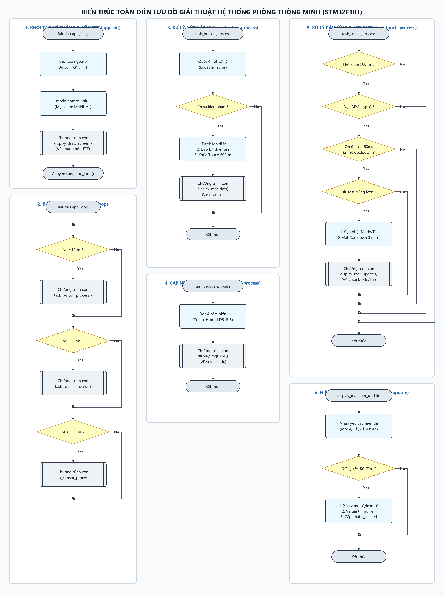

# BTL_TKHTN: Bài tập lớn Thiết kế Hệ thống Nhúng - HCMUT (Nhóm 10 - Software)

Hệ thống nhúng điều khiển phòng thông minh sử dụng vi điều khiển **STM32F103C8T6**, màn hình màu **LCD TFT ILI9341 (320x240)** tích hợp cảm ứng điện trở **XPT2046**, 4 nút bấm vật lý ưu tiên cao và các cụm cảm biến môi trường.

---

## 🏛️ Kiến Trúc Phân Tầng Phần Mềm

Dự án tuân thủ nghiêm ngặt mô hình kiến trúc phân tầng chuẩn công nghiệp:
- **Application Layer (`Application/`)**: Điều phối logic cấp cao, hoàn toàn độc lập với phần cứng.
  - `app_main.c`: Bộ lập lịch tuần hoàn không chặn (`app_loop`) chia sẻ thời gian (10ms, 30ms, 500ms).
  - `mode_control.c`: Máy trạng thái quản lý chế độ hoạt động (`AUTO` / `MANUAL`).
  - `display_manager.c`: Quản lý hiển thị TFT, giải mã Hit-Test và thuật toán vẽ vi sai (**Differential Partial Redraw**).
- **System Layer (`System/`)**: Trình điều khiển thiết bị trung gian (BSP).
  - `button.c`: Xử lý quét nút bấm vật lý và lọc rung tích lũy 2 mẫu ($20\,\text{ms}$).
  - `ili9341.c`: Giao tiếp điều khiển màn hình LCD qua SPI phần cứng tốc độ cao (18 MHz).
  - `xpt2046.c`: Đọc tọa độ cảm ứng điện trở 12-bit qua SPI.
- **Hardware/Driver Layer (`Core/`, `Drivers/`)**: Cấu hình ngoại vi CubeMX và thư viện STM32F1xx HAL.

---

## 📊 Kiến Trúc Lưu Đồ Giải Thuật (Flowcharts)

Toàn bộ giải thuật được module hóa thành 6 lưu đồ chuẩn SVG (tuân thủ quy tắc lưới $20\,\text{px}$, Yes đi xuống, No sang phải, 0 giao cắt):

| STT | Khối chức năng | Tệp SVG độc lập | Mô tả chi tiết |
| :---: | :--- | :--- | :--- |
| **1** | Khởi tạo & Giao diện nền | [`docs/figures/flowchart_01_init_display.svg`](docs/figures/flowchart_01_init_display.svg) | Khởi tạo ngoại vi & vẽ khung nền TFT tĩnh (`app_init`) |
| **2** | Bộ lập lịch chính | [`docs/figures/flowchart_02_main_scheduler.svg`](docs/figures/flowchart_02_main_scheduler.svg) | Lập lịch tuần hoàn không chặn 10ms, 30ms, 500ms (`app_loop`) |
| **3** | Xử lý nút vật lý | [`docs/figures/flowchart_03_task_button.svg`](docs/figures/flowchart_03_task_button.svg) | Lọc rung 20ms, ép MANUAL, khóa cảm ứng 500ms (`task_button_process`) |
| **4** | Xử lý cảm ứng & Hit-Test | [`docs/figures/flowchart_04_task_touch.svg`](docs/figures/flowchart_04_task_touch.svg) | Lọc rung 60ms, hit-test nút ảo, điều khiển Mode/thiết bị (`task_touch_process`) |
| **5** | Quản lý hiển thị vi sai | [`docs/figures/flowchart_05_display_manager.svg`](docs/figures/flowchart_05_display_manager.svg) | Thuật toán vẽ vi sai chống nháy màn hình TFT (`display_manager_update`) |
| **6** | Cập nhật cảm biến | [`docs/figures/flowchart_06_task_sensor.svg`](docs/figures/flowchart_06_task_sensor.svg) | Đọc 4 cảm biến môi trường & chuyển tiếp hiển thị (`task_sensor_process`) |

> 📖 **Xem thuyết minh chi tiết kèm lưu đồ Mermaid:** [`docs/FLOWCHARTS.md`](docs/FLOWCHARTS.md)

### Sơ đồ toàn cảnh (Master Overview)


---

## 📁 Cấu Trúc Thư Mục Dự Án

```
BTL_TKHTN2/
├── Application/                 # Tầng ứng dụng (Pure Logic, Zero HAL dependency)
│   ├── app_main.c/.h            # Vòng lặp chính & khởi tạo
│   ├── mode_control.c/.h        # Quản lý chế độ AUTO / MANUAL
│   └── display_manager.c/.h     # Quản lý vẽ giao diện vi sai & Hit-test
├── System/                      # Tầng hệ thống / BSP Drivers
│   ├── button.c/.h              # Driver nút bấm vật lý (Debounce 20ms)
│   ├── ili9341.c/.h             # Driver màn hình TFT LCD SPI 18MHz
│   ├── xpt2046.c/.h             # Driver cảm ứng điện trở SPI
│   └── sys_types.h              # Định nghĩa kiểu dữ liệu dùng chung
├── Core/                        # CubeMX Hardware Setup (GPIO, SPI, USART, SysTick)
├── Drivers/                     # CMSIS & STM32F1xx HAL Drivers
├── docs/                        # Tài liệu & Lưu đồ giải thuật SVG / PNG
│   ├── FLOWCHARTS.md            # Tài liệu giải thích lưu đồ
│   └── figures/                 # Toàn bộ ảnh và vector SVG chất lượng cao
├── Overleaf_Docs/               # Bản nháp báo cáo môn học Overleaf LaTeX
├── BTL_TKHTN2.ioc               # File cấu hình STM32CubeMX
└── STM32F103C8TX_FLASH.ld       # Linker script STM32F103C8T6 (64KB Flash, 20KB RAM)
```

---

## 🛠️ Hướng Dẫn Biên Dịch & Nạp Code

1. Mở dự án bằng **STM32CubeIDE** (`File -> Open Projects from File System...` và chọn thư mục này).
2. Nhấn `Ctrl + B` để biên dịch (Build Project).
3. Kết nối mạch nạp **ST-Link V2** với vi điều khiển STM32F103C8T6 (SWDIO, SWCLK, GND, 3V3).
4. Nhấn `Run` (`Ctrl + F11`) để nạp chương trình và kiểm tra vận hành trên phần cứng.
