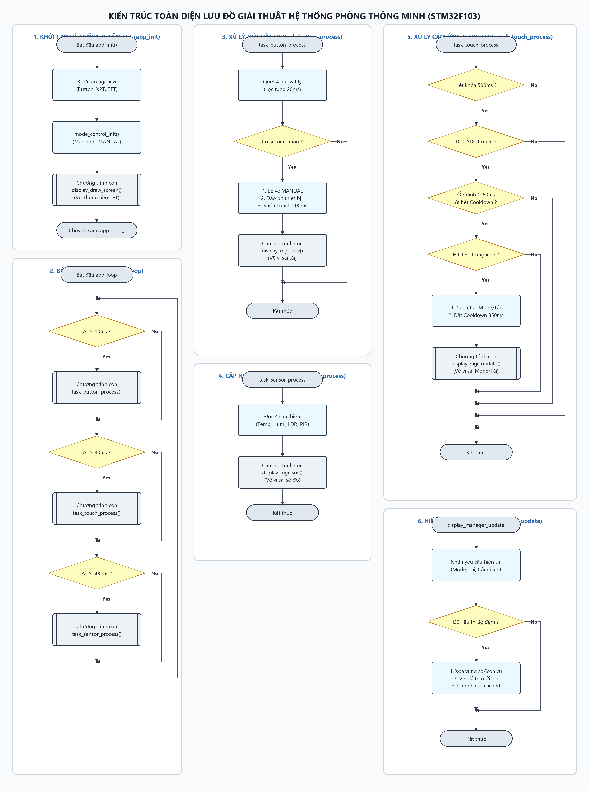
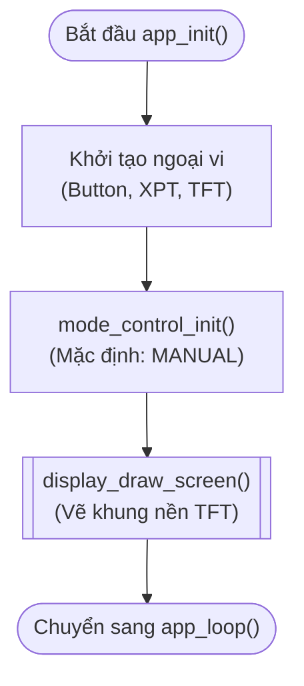
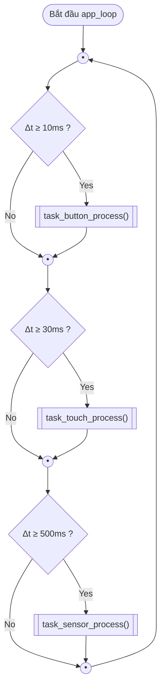
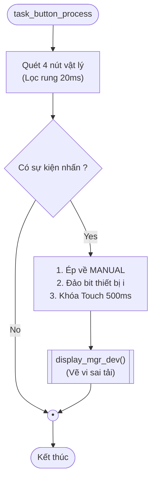
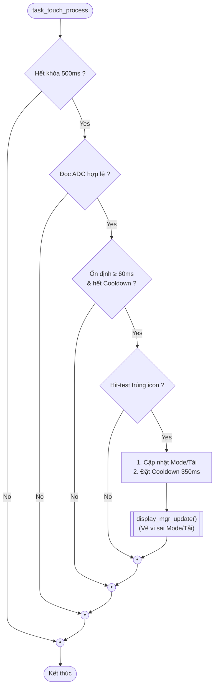
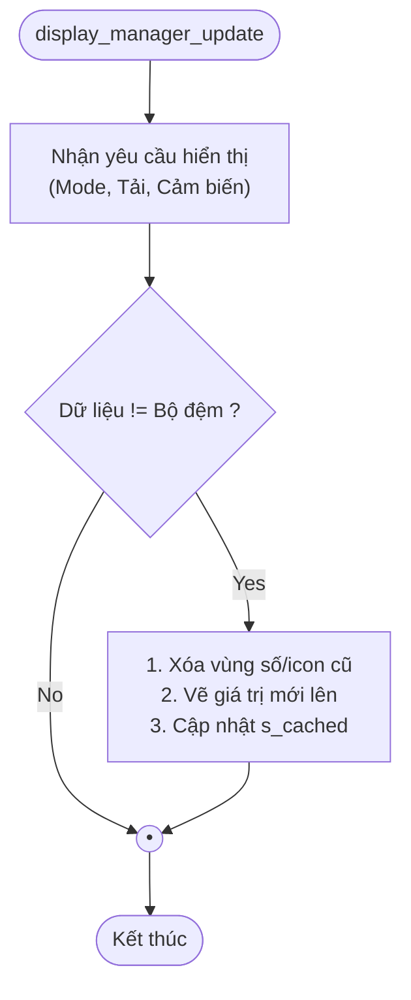
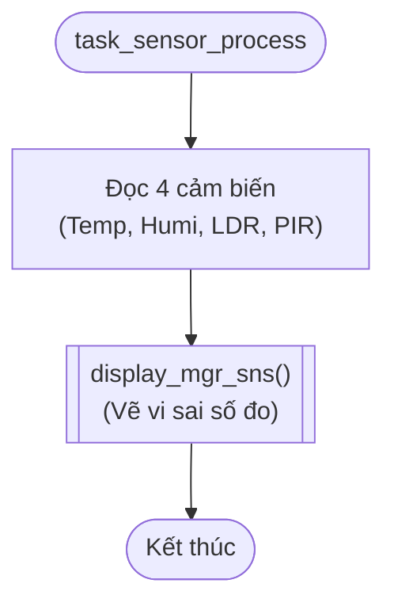

# Kiến Trúc Lưu Đồ Giải Thuật Hệ Thống Điều Khiển Phòng Thông Minh (STM32F103)

Tài liệu này mô tả chi tiết lưu đồ giải thuật của tầng ứng dụng (**Application Layer**) gồm 3 khối cốt lõi:
- **`app_main.c`**: Bộ lập lịch vòng lặp chính (`app_loop`) và khởi tạo (`app_init`).
- **`mode_control.c`**: Máy trạng thái chế độ hoạt động (`AUTO` / `MANUAL`).
- **`display_manager.c`**: Quản lý hiển thị TFT ILI9341, giải mã tọa độ chạm Hit-Test và thuật toán vẽ vi sai (**Differential Partial Redraw**).

---

## 1. Toàn Cảnh Hệ Thống (Master Architecture Overview)

Hệ thống được thiết kế theo cấu trúc module hóa (Modular Architecture):

*Hình 1: Toàn cảnh 6 khối lưu đồ giải thuật hệ thống điều khiển phòng thông minh.*

---

## 2. Chi Tiết Từng Khối Lưu Đồ

### 2.1. Khởi Tạo Hệ Thống & Giao Diện Nền (`app_init()`)
- **Tệp nguồn:** [`Application/app_main.c`](file:///d:/Nam_3/TKHTN/BTL/Core/Src/Application/app_main.c) & [`Application/display_manager.c`](file:///d:/Nam_3/TKHTN/BTL/Core/Src/Application/display_manager.c)
- **Tệp đồ họa:** [`flowchart_01_init_display.svg`](figures/flowchart_01_init_display.svg)
- **Mục tiêu:** Cấu hình ngoại vi, thiết lập chế độ mặc định `MANUAL` và vẽ bộ khung giao diện tĩnh lên màn hình TFT trước khi bước vào vòng lặp vận hành.

---

### 2.2. Bộ Lập Lịch Tuần Hoàn Không Chặn (`app_loop()`)
- **Tệp nguồn:** [`Application/app_main.c`](file:///d:/Nam_3/TKHTN/BTL/Core/Src/Application/app_main.c)
- **Tệp đồ họa:** [`flowchart_02_main_scheduler.svg`](figures/flowchart_02_main_scheduler.svg)
- **Mục tiêu:** Chia sẻ thời gian qua 3 lát thời gian (Time-slices) độc lập:
  - $\Delta t \ge 10\,\text{ms}$: Quét nút vật lý (Ưu tiên cao nhất).
  - $\Delta t \ge 30\,\text{ms}$: Quét cảm ứng điện trở màn hình.
  - $\Delta t \ge 500\,\text{ms}$: Đọc cảm biến môi trường và làm mới số đo.

---

### 2.3. Chương Trình Con: Xử Lý Nút Bấm Vật Lý (`task_button_process()`)
- **Tệp nguồn:** [`Application/app_main.c`](file:///d:/Nam_3/TKHTN/BTL/Core/Src/Application/app_main.c) & [`Application/mode_control.c`](file:///d:/Nam_3/TKHTN/BTL/Core/Src/Application/mode_control.c)
- **Tệp đồ họa:** [`flowchart_03_task_button.svg`](figures/flowchart_03_task_button.svg)
- **Mục tiêu:** Lọc rung 2 mẫu liên tiếp ($20\,\text{ms}$). Khi có sự kiện nhấn nút:
  1. Tự động ép chế độ về `MANUAL`.
  2. Đảo bit trạng thái tải tương ứng.
  3. Khóa cảm ứng trong $500\,\text{ms}$ (`touch_lockout_until = now + 500ms`) để triệt tiêu nhiễu màn hình.
  4. Gọi `display_mgr_dev()` vẽ vi sai cập nhật nút tải.

---

### 2.4. Chương Trình Con: Xử Lý Màn Hình Cảm Ứng (`task_touch_process()`)
- **Tệp nguồn:** [`Application/app_main.c`](file:///d:/Nam_3/TKHTN/BTL/Core/Src/Application/app_main.c) & [`Application/display_manager.c`](file:///d:/Nam_3/TKHTN/BTL/Core/Src/Application/display_manager.c)
- **Tệp đồ họa:** [`flowchart_04_task_touch.svg`](figures/flowchart_04_task_touch.svg)
- **Mục tiêu:** 
  - Kiểm tra xem có đang bị khóa bởi nút vật lý không (`Hết khóa 500ms?`).
  - Lọc rung 2 mẫu ổn định ($60\,\text{ms}$) và kiểm tra thời gian hồi phục ($350\,\text{ms}$).
  - Giải mã tọa độ chạm qua `display_manager_hit_test()`:
    - Nếu chạm nút **MODE**: Đảo qua lại giữa `AUTO` và `MANUAL`.
    - Nếu chạm nút **THIẾT BỊ**: Ép về `MANUAL` và đảo bit thiết bị.
  - Gọi chương trình con `display_mgr_update()` để vẽ vi sai.

---

### 2.5. Chương Trình Con: Quản Lý Hiển Thị Vi Sai (`display_manager_update()`)
- **Tệp nguồn:** [`Application/display_manager.c`](file:///d:/Nam_3/TKHTN/BTL/Core/Src/Application/display_manager.c)
- **Tệp đồ họa:** [`flowchart_05_display_manager.svg`](figures/flowchart_05_display_manager.svg)
- **Thuật toán cốt lõi (Differential Partial Redraw):**
  - So sánh giá trị hiển thị mới với bộ đệm trạng thái cũ (`s_cached_*`).
  - **Nếu khác biệt:** Xóa vùng chữ số cũ bằng `ili9341_fill_rect()`, vẽ chuỗi ký tự mới với Scale 2, cập nhật giá trị vào `s_cached_*`.
  - **Nếu không đổi:** Bỏ qua hoàn toàn, không gửi lệnh SPI tới màn hình, giúp loại bỏ hoàn toàn hiện tượng nhấp nháy (flicker-free).

---

### 2.6. Chương Trình Con: Cập Nhật Cảm Biến Môi Trường (`task_sensor_process()`)
- **Tệp nguồn:** [`Application/app_main.c`](file:///d:/Nam_3/TKHTN/BTL/Core/Src/Application/app_main.c)
- **Tệp đồ họa:** [`flowchart_06_task_sensor.svg`](figures/flowchart_06_task_sensor.svg)
- **Mục tiêu:** Đọc số đo 4 cảm biến và chuyển tiếp dữ liệu đến module hiển thị vi sai.

